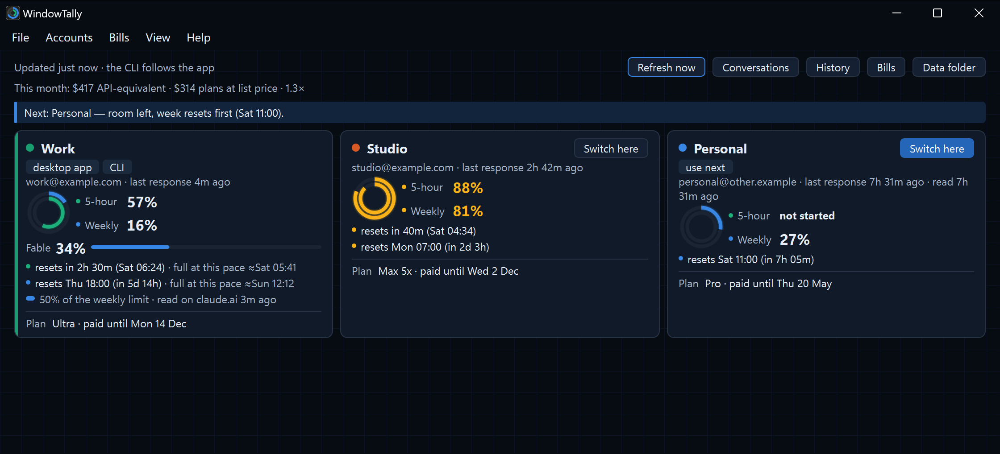
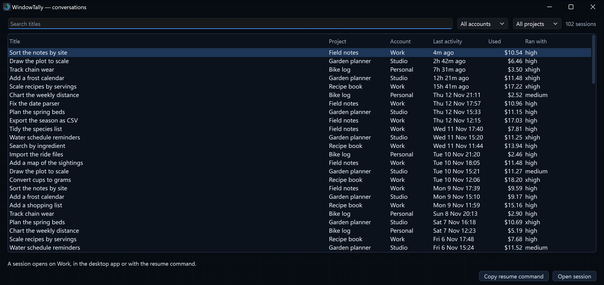
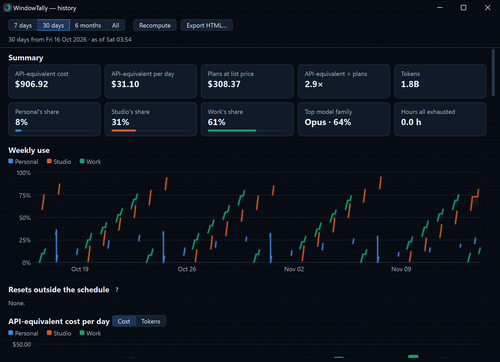
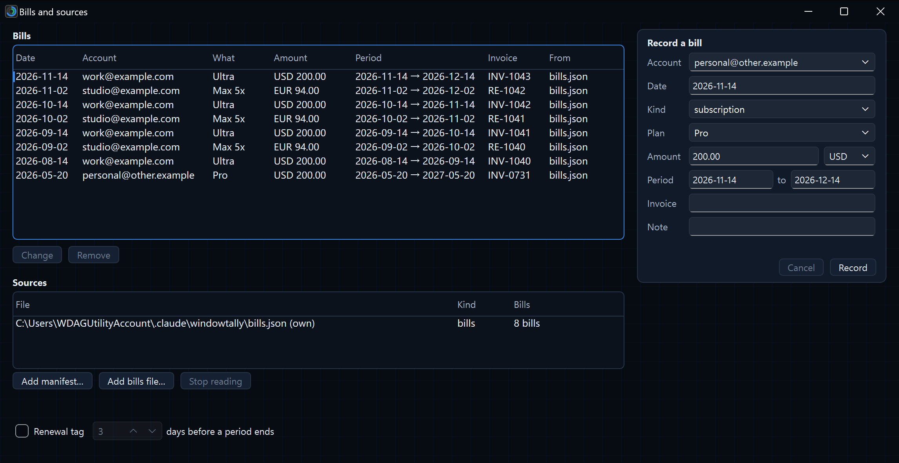

# WindowTally

WindowTally is for one person who uses several Claude subscription accounts on one Windows machine, in the Claude
desktop app and the Claude Code CLI. It shows how far every account's 5-hour and weekly limits are used and which
account to use next, keeps a lasting record of what each account used — what it would have cost at API prices, beside
what its plans cost at list price — and switches the desktop app and the CLI from one account to another without a
browser sign-in, once each account has signed in once.

> **Status.** Provided as is, with no promise of maintenance or support (see [Feedback](#feedback)). Windows only:
> tested on Windows 11 version 22H2, 64-bit. WindowTally is not made by Anthropic and is not affiliated with it, and
> it relies on parts of Anthropic's apps that Anthropic does not document, which an update of an app can break
> ([What it relies on](#what-it-relies-on)).

It has five parts:

- **Account sync** (`sync/`): the Claude Code CLI follows whichever account the Claude desktop app is signed in
  to, switching sign-ins without a browser login once each account has signed in once. It also switches the desktop
  app itself from one account to another, the same way, when the window asks (*Switching accounts*, below).
- **Ledger service** (`windowtally/`): a background process that records every Claude Code response — account,
  model, effort, tokens, API-equivalent cost — every plan-limit reading, and each session's title, the permission
  mode it last ran in, the turns a plan limit refused and the background tasks it started, keeps them after their
  sources expire, and writes each account's
  live standing to `status.json` and
  a history page to `dashboard.html`. From
  the bills you record it also works out what each account's plans cost at their US list price and how far each
  account is paid up. While a Claude Code session is at work — the desktop app's, a terminal's or a scripted run's — it
  keeps the computer from going to sleep, unless you turn that off (*The window*, below).
- **Desktop plugin** (`plugin/`): a Claude Code plugin loaded in every session, the desktop app's Code tab and the
  CLI alike, that hands the ledger service each session's plan readings, shows every account's standing in a band
  above the prompt, warns as the account in use fills its limits, and marks the sessions the desktop app hosts while
  a turn is in progress, for programs on your computer that watch for sessions at work; WindowTally itself reads
  Claude Code's own record of its sessions.
- **Window** (`windowtally_gui/`): a desktop window with a tray icon that shows every account's standing live
  outside Claude Code, switches accounts with a click — taking along, when it switches the desktop app, the sessions
  you choose of the account it leaves — lists every account's Code sessions in one place, from which one opens on the
  account in use, and carries WindowTally's actions and your bills (*The window*, below).
- **Browser extension** (`extension/`), optional: a Chrome extension that brings chat on claude.ai in a browser into
  WindowTally, handing the 5-hour and weekly figures claude.ai's own page receives, the week's use split by
  product and a model's own weekly window, Fable's, to a small host of the ledger service's package (*The browser
  extension*, below). WindowTally stands whole without it.

## What account switching does, and does not do

- **One person's own subscriptions, on one machine, each within its own limits.** Every account is used within its
  own weekly limit and, where its plan has one, its own 5-hour limit. The weekly limit is the one that binds, and
  switching carries no account past it: switching changes only which account Anthropic's apps are signed in to, and
  each account's use still counts against that account's own limits. The history's *Full window*, by plan
  (below), measures, plan by plan, how many full 5-hour windows a full weekly window held on your own use, against
  the 33.6 a week holds back to back.
- **A session taken along to another account goes on under that account's limits.** When the window switches the
  desktop app it can open sessions of the account it leaves on the account it switches to (*Switching accounts*,
  below), and its Conversations window opens a session of any account on the account in use (*The window*, below).
  From then on the session runs on that account: its later turns are sent by the desktop app, or the CLI, signed in to
  it and count against that account's own limits, as the ledger records them, while its earlier turns stay counted
  against the account that answered them. Taking a session along lends it no other account's allowance and lifts no
  limit.
- **No network request of its own.** No part of WindowTally sends a network request: what goes over the network is
  sent by Anthropic's own apps, as when you use them without it. The ledger service, the window, the plugin and the
  browser extension read no credential; the extension reads only the usage responses claude.ai's page itself
  received, and WindowTally opens no listening port.
- **Sign-ins stay on this machine, in Anthropic's apps.** Only the account sync handles a sign-in — the CLI's, and
  the desktop app's login. It stores each account's sign-in on this machine, sealed with Windows DPAPI for your
  Windows user, and puts it back into Anthropic's own apps when you switch; it never uses one to send a request. The
  window never touches a sign-in: it asks the sync to switch.
- **Not a shared token pool, a proxy or a way to share an account.** Every account stays yours, signed in on your
  own machine and used through Anthropic's own apps; nothing is lent, pooled or relayed.
- **It relies on what Anthropic does not document.** Switching the desktop app relies on the app's undocumented
  storage and log, which an update of the app can break, and the browser extension on claude.ai's page asking for
  its usage, which an update of the site can break (*What it relies on*, below).
- **Whether this suits Anthropic's terms is yours to judge.** Read Anthropic's
  [Consumer Terms](https://www.anthropic.com/legal/consumer-terms) and Claude Code's
  [Legal and compliance](https://code.claude.com/docs/en/legal-and-compliance) page before you use it.

## What it relies on

WindowTally is not made by Anthropic, and Anthropic does not endorse it. It reads — and the account sync writes —
parts of Anthropic's apps and of claude.ai that Anthropic does not document as an interface. An update can change any
of them:

- **The desktop app's login storage**: the `oauth:tokenCacheV2` and `lastKnownAccountUuid` values of its
  `config.json` and its `Network\Cookies` file, which the account sync stores and puts back to switch the app, and
  the `windowSizeWasSignedIn` value beside them, by which it tells whether the app is signed in. Laid out otherwise,
  the sync refuses to switch, changing no login, and says why.
- **The desktop app's log**, `main.log`: its lines on a sign-in and on coming up signed out, by which the sync tells
  whether the app took the login a switch gave it, and waits for a sign-in to be saved before it closes the app.
  Should those lines change, a switch the app refuses may be reported done (*Limits*).
- **The desktop app's feature flag `96101707`**, which marks the app's own support for several accounts. While it is
  present the sync refuses to switch the app; it has no other sign of that support.
- **The desktop app's plan-usage history**, `plan-usage-history.json`: the 5-hour and weekly percentages the app
  samples while it runs. A file of another version is refused, with an error named among the problems the service
  met reading its sources.
- **Claude Code's transcripts** under `%USERPROFILE%\.claude\projects`: every response's model, effort and tokens,
  from which the ledger counts its API-equivalent cost; each session's title lines, `custom-title` (the title the
  desktop app shows) and `ai-title` (the one Claude Code makes up itself); the permission mode a session's prompts
  and its `permission-mode` lines name; the line of a turn a plan limit refused,
  an error message marked `rate_limit`, which from Claude Code 2.1.299 also names the window that refused it and its
  reset; the tool result on which a session starts a background task, a command or a subagent, and the notification
  that names the task and how it ended, or the result of a stop the session made itself; and the folder each response
  ran in and the client that ran it, `claude-desktop` for the desktop app's Code tab and `cli` for the CLI. Written
  otherwise, the costs and tables built on them can be wrong, a switch of the desktop app offers the sessions it
  leaves without their titles, without the mark of a limit or without that of background work unfinished, both lists
  say less of what a session ran with, and the Conversations window lists a session without its project, or leaves it
  out.
- **Claude Code's record of its running sessions**, one file per running Claude Code process under
  `%USERPROFILE%\.claude\sessions`, naming its session, its process and whether a turn is in progress, by which the
  service keeps the computer awake and the window asks before it closes the desktop app. The files beside them that
  end in `.key` are never opened. A file WindowTally does not recognise is named among the problems the service met
  reading its sources, and its session counts as not at work: the computer is then not kept awake for it, and a switch
  of the desktop app does not ask about it.
- **The desktop app's resume link**, `claude://resume?session=<id>`, the id being the session's own as its transcript
  names it, through which the window opens a session it takes along on the account it switched to, and a session the
  Conversations window opens on the account in use. The app does not document it. Measured on 2026-11-07 under the
  desktop app 3.6556.2.0, it had the app take up a session of another account under the account it was signed in to,
  which then answered there; the session kept its title but not its effort, and its permission mode can fall back to
  the default. Read in the desktop app 4.23118.1.0 on 2026-11-11, the link carries the session's id alone: the app
  takes the session's model and permission mode from the last lines of its transcript, the default mode of its
  settings where those name none and accepting edits where the session bypassed permissions, and its effort from
  nothing, so the window shows what each session last ran with, for you to set it again. Should an update change it, a session taken along or opened may not open, and WindowTally may not
  tell: it knows only whether Windows could hand the link on.
- **The Claude Code CLI's sign-in file**, `%USERPROFILE%\.claude\.credentials.json`, **and its account profile**,
  the `oauthAccount` object of `%USERPROFILE%\.claude.json`, which the account sync stores and puts back to switch
  the CLI. Laid out otherwise, the sync stops with an error instead of guessing, and its `claude` launcher does not
  start the CLI.
- **claude.ai's page asking for its usage** (`/api/organizations/<organization>/usage`), whose responses the browser
  extension reads: the 5-hour and weekly windows, the week's use by product, and the per-model weekly windows, such as
  Fable's. Should the site change it, the extension reads nothing and WindowTally goes on as without it; should it
  change only the use by product or the per-model windows, the windows still arrive and that part does not.

## What it looks like

The accounts in these pictures are invented, and the windows wear their dark mode.



*The window: every account's 5-hour and weekly windows as rings beside their figures, then each window's line with its
reset and pace; the account the desktop app and the CLI use, Work, is marked by a strip of its colour, and its card also
shows Fable's own weekly window under the rings, with its bar. The window's actions stand at the right end of its first
line. Studio's 5-hour window is near its limit; Personal is the one to use next, its Switch button filled, its 5-hour
window has not started, and its reading is old enough that its age is said.*



*The Conversations window: every account's Code sessions, each with its project, the account it is on, its last
activity, what it used at API prices and the effort it ran with; the session chosen opens on Work, the account the
desktop app is on.*



*The History window over 30 days: what the accounts used at API prices beside their plans' cost at list price, each
account's weekly window, week by week, and the cost per day, which the switch beside its heading turns to tokens.*



*The Bills and sources window: each account's bills, and the form a bill is recorded through.*

## Download and start

A release is a zip that carries everything WindowTally runs on, Python included, so nothing else is installed.
WindowTally needs besides:

- Windows 11 (tested on version 22H2, 64-bit), with Windows PowerShell 5.1, which Windows includes.
- The Claude desktop app, and the Claude Code CLI's native install, `%USERPROFILE%\.local\bin\claude.exe`, which the
  account sync and the installer use.
- Chrome, only for the optional browser extension.

1. From the [releases page](https://github.com/offcutworks/windowtally/releases), download
   `WindowTally-<release>.zip` and `SHA256SUMS`.
2. Check the download. In PowerShell, in the folder you saved both to, run `Get-FileHash .\WindowTally-<release>.zip`:
   the hash it prints must be the one `SHA256SUMS` gives for that file. If it is not, delete the file.
3. Unpack it (right-click it, *Extract All...*), open Windows PowerShell in the unpacked folder and run:

   ```powershell
   powershell -NoProfile -ExecutionPolicy Bypass -File .\install.ps1 -Mode Install
   ```

`Install` sets WindowTally up for your Windows account and starts the ledger service and the window, which waits in
the notification area (*Install, check, remove*, below). It copies everything it runs, the release's Python
included, to `%USERPROFILE%\.claude\windowtally\app`, so WindowTally goes on running when the unpacked folder is moved
or deleted; keep a release's folder all the same, since `Status` and `Uninstall` run from one.

**Updating.** Unpack a newer release into a folder of its own and run its `install.ps1 -Mode Install` there. It
replaces the installed copy, Python included, and keeps your data; the older release's folder can then be deleted.
While a command you started under the installed copy's Python still runs, `Install` and `Uninstall` change nothing
of it and name what runs: let it end, then run them again.

## Install, check, remove

From a release's unpacked folder, in Windows PowerShell:

```powershell
powershell -NoProfile -ExecutionPolicy Bypass -File .\install.ps1 -Mode Install
powershell -NoProfile -ExecutionPolicy Bypass -File .\install.ps1 -Mode Status
powershell -NoProfile -ExecutionPolicy Bypass -File .\install.ps1 -Mode Uninstall
```

`Install` updates the account sync in `%USERPROFILE%\.claude\bin` (keeping a copy of each file it replaces under
`%USERPROFILE%\.claude\windowtally\backup\`) and restarts its watcher, which runs from the logon task
`\WindowTally\Sync`; it copies the service and the window, with the licence, the release's third-party notices, its
build record and its Python, `runtime\`, to `%USERPROFILE%\.claude\windowtally\app`, and registers the logon tasks
`\WindowTally\Service` and `\WindowTally\Window`, at normal priority, which run the installed copy under that copy of
Python; it writes the window's Start menu entry, which shows the logo, drawn into `windowtally.ico` beside the
packages, and starts the service and the window. Every task WindowTally registers sits in the Task Scheduler folder
`WindowTally`, where you find them together. `-SkipSync` leaves the account sync as it is. The interpreter defaults
to the one a release carries, `runtime\pythonw.exe`; a source folder carries none, so `-Python` names one there
(*Running from source*), and the installed copy then runs under it where it is. `Install` then copies the plugin to
`%USERPROFILE%\.claude\windowtally\plugin` and installs it from there at user scope; each Claude Code session loads it
at its next start or `/reload-plugins`. The plugin is installed with the native Claude Code CLI,
`%USERPROFILE%\.local\bin\claude.exe` unless `-Claude` names another. `Status` reports the three logon tasks and
their priority, whether the plugin is installed and enabled, which folder sessions read it from, whether each
installed copy — the licence's, the notices', the build record's and Python's included — matches this folder, whether
the Start menu entry exists, and the standing the service last wrote, read through the installed copy's Python;
`Uninstall` removes the plugin, its marketplace and its copy, the window with its task and Start menu entry, and the
service with the installed copy, its Python included, and keeps the data unless `-RemoveData`. `Uninstall` removes
the Start menu entry and the browser extension's host by running the installed copy's code under the installed
copy's Python, so any release's folder removes an installation made from a release; `Install`, and `Uninstall` of a
copy installed from source, refuse to run without the interpreter `-Python` names. The account sync stays; its own
`UninstallWatcher` mode stops its watcher and removes the watcher's logon task:

```powershell
powershell -NoProfile -ExecutionPolicy Bypass -File "$env:USERPROFILE\.claude\bin\WindowTallySync.ps1" -Mode UninstallWatcher
```

*The `claude` launcher.* The account sync carries `claude.cmd`, a launcher that brings the CLI onto the desktop app's
account before it starts `claude.exe`, and stores the sign-in that a `claude auth login` through it produces.
`Install` copies it beside the sync and changes no PATH. To have `claude` run it, add that folder to your user PATH
once:

```powershell
powershell -NoProfile -ExecutionPolicy Bypass -File "$env:USERPROFILE\.claude\bin\WindowTallySync.ps1" -Mode Install
```

It adds `%USERPROFILE%\.claude\bin` at the end of your user PATH, and `-Mode Uninstall` takes it out; a terminal
opened afterwards sees the change. A `claude` in a folder earlier on the PATH runs instead — the native install's
`%USERPROFILE%\.local\bin`, where your PATH holds it. Without the launcher the watcher still keeps the CLI on the
desktop app's account.

## What it tells you

For every account: the 5-hour window (percent and reset time, or *not started* once it has ended with no message
since), the weekly window (percent and reset time), how old the reading is, and which account to use next (the
one with room left whose weekly allowance expires first or, with every account near its limit, the one with the most
of its week left). An account you hid (*The window*, below) is never the one to use next, nor is one whose bills
(*Recording bills*, below) record a plan that has ended and none since: such an account takes no readings, so its
windows, rolled on through their resets, would read as room left. With every account hidden or its plan ended, none is
recommended and WindowTally says so. An account whose plan has no 5-hour limit — Anthropic removes it account by
account — is read as such once its readings have carried the weekly window alone for a quarter of an hour; it is then
shown with its weekly window first and *no limit* for the 5-hour one — the band shows its weekly window alone — and
recommended and warned of by its weekly window alone.
The history page adds a summary of the last thirty days —
the API-equivalent cost in all and per day, the part of it paid outside the plans where there was any, the plans' cost
at list price and the use the plans covered as a multiple of it, with resets and, where the two differ, without them
(below), the tokens, each account's share, the costliest model family and the hours when every account was
exhausted — then
six weeks of weekly usage, daily API-equivalent cost by account and by model family, tokens, the hours when every
account was exhausted, tables of sessions, prompts, models and effort, and the cost by the size of a request's
context. The window's History window shows the same over 7 days, 30 days, 6 months or the whole history, and saves
what it shows as one HTML file (*The window*, below).

The tokens count the same responses as the cost charts: each account's tokens per day over the last thirty days, on
the cost chart's columns and in its place, a switch beside the heading showing the cost or the tokens; then, after the
cost by model family, the tokens by week from Monday over the last six weeks or by calendar month over the whole
history, in local time, a second switch choosing. A table has a column for each account with tokens in its range,
then every kind — input sent uncached, output with the thinking inside it, cache writes at either lifetime, cache
reads — all tokens, which counts thinking once, inside output, and the same responses' API-equivalent cost; its last
row is the range in all. Together, the tokens and the dollars tell a change in how much work went through the accounts from a
change in what it cost — a price, or the mix of models and token kinds. The band, its panel and the window's cards
show no tokens.

The context table follows the effort table and counts every account together. A request's context is every token it
sent — input uncached, cache reads and cache writes — and each turn sends the whole conversation again, so a long
session pays for its length on every response. The table gives, by the size of the request's context — under 100K,
100K–200K, 200K–500K, and 500K and over — the responses, the sessions with a response there, the tokens sent, the
API-equivalent cost, its share of the whole and the cost per response, then the span in all. A line beneath counts
the responses rewritten after a pause: those that came longer after the previous response of their session or
subagent than the cache they write lives — an hour, or five minutes — and wrote more to the cache than they read,
most often because the cache had expired, with what writing the earlier request's context again cost beyond reading
it. The first response of a session or subagent in the span is never counted, nor one of a model with no list
price. The figures are
for you to read; WindowTally gives no advice on them.

Where the browser extension is loaded, an account's weekly window also carries claude.ai's own split of the week's use
by product — Claude Code, Chats, Cowork and Other, as its usage page shows them under *This week's usage by product* —
each product's share of the window's use so far in whole percents, with how old the report is. The plugin's panel and
the window's cards end the weekly window's words with the products that took a share, where more than one did, such
as `by product 3h ago: Claude Code 82%, Chats 18%`, and the history page's account cards say the same with the
report's time. Under the
weekly usage chart, the history page and the History window give a table of each weekly window's last report: the
account, when the window began, the weekly figure the report came with, each product's share beside the points of the
weekly limit it stands for, to the whole point — `15% · 8 pts` is 15 % of a week at 54 % — and when claude.ai made
the report; a product claude.ai adds gets a column under its own name. No figure, warning or recommendation rests on
it, and an account with no report of its current window shows none.

Where the browser extension is loaded, an account that has used Fable also shows Fable's own weekly window: claude.ai
gives Fable an allowance of its own inside the weekly limit — half of it, on the plan it was read on — and past that
allowance Fable goes on at usage credits, outside the plan. Its figure is a percentage of that allowance, read from
claude.ai's page and carried forward between readings, marked **≈**, by Fable's part of the weekly figure's rise
since, which is shared with the other models by what each cost here, each at the weekly points its dollar has taken
lately: the plan counts a dollar of Fable for more than a dollar of the others. A reset of the allowance, which you
can take on claude.ai, is read from the weekly figure falling by Fable's part of it, and a fall
that cannot be told apart shows the window as *unknown* until claude.ai is read again. The band shows it after the
weekly window, as `Fable ≈24%`; the panel gives it a row under the weekly window, with the allowance's share of the
week and how old the claude.ai reading is; the window's cards a third window under the two rings, with a thin bar in
place of a ring. An account
that has not used Fable shows none. The weekly window's *full at this pace* time stops counting Fable's part of the
pace once its allowance is full, since its use then no longer raises the week. No recommendation rests on it.

The weekly figure can also fall inside its week, outside the schedule, when you take a reset: Anthropic hands resets out
at random, free and not for sale, and you take each when you choose — of the week, an extra reset, or of Fable's
allowance, which gives back Fable's part of it. The week's own reset still comes at its fixed time. The weekly usage
chart, on the history page and in the History window, marks each such fall by its kind in the account's colour — a
disc for an extra reset, a diamond for Fable's allowance, a square where the readings cannot tell which — and under it
*Resets outside the schedule* gives a row per account and week with one: how many of each kind, the points they gave
back, and the use beyond one full weekly window they made room for. Two parts of the use would make the plans look
worth more than they gave, and WindowTally takes both out where it sets the use against the plans' cost. The use paid
at extra usage — while a window stood at 99 % or more, or Fable's past its own allowance — is said as *outside the
plans* and counted in no multiple, nor in what a full window holds. The use past one full window in a week, which only
a reset made room for, is left out of a second multiple, *without resets*, which stands beside the first wherever the
two read differently.
Both are read from the readings alone (*Limits*, below).

A model the list prices do not yet name has its responses counted at no cost until they do, and is named among the
problems the service met reading its sources; once the prices name it, its responses already recorded are priced.

Figures marked **≈** are estimated: a reset time inferred from the desktop app's samples, or a rise estimated
from the cost of the responses since the last reading.

With bills recorded (*Recording bills*, below), every account also shows its plan today, the day it is paid up to
and the days left — on the window's cards and the history page's, the days left only within a week of the renewal —
or the day its plan ended — and the `status` command and the window's header this month's totals
across the accounts. Where some of an account's bills could not be read, it says *bills not all read* and points to
the source problems instead, never that it has no bills or no plan, and while any bill is unread this month's plans
at list price is said not to be known. Every subscription cost is the plans' US list price, in US
dollars — Pro $20 a month or $200 a year, Max 5x $100 and Ultra $200 a month — spread over each period's days and
counted on the days the plan was in effect, so it stands beside the API-equivalent cost in one currency; it is never
what a bill was charged, and a top-up or a settlement of extra usage counts in no figure. The history page's
*Subscriptions* section adds the plans' cost per
month and per day with a plan, every plan period — how it began (first order, renewal, change of plan, new order
after a gap), its cost at list price and the API-equivalent use of the account while it held, with the part of it
paid outside the plans and the use the plans covered as a multiple of that cost, with resets and, where the two
differ, without them, and the sum refunded beside a bill a refund credits — and the gaps between recorded periods,
with the days
another account covered. Where the account's profile
names another plan than the bills, the page and the panel say so. After the subscriptions, *Full window* gives,
by plan, the API-equivalent dollars one full 5-hour window and one full weekly window held over six weeks, and, by
week, whether that changed, a switch beside its heading choosing which: the cost of the Claude Code responses between
two close readings of an account on the plan, over the points its window rose, the use paid outside the plans
counting nothing, since it raised no window. It is counted as though all of the account's use were
Claude Code here, and the section says so first: the readings also rise with the Chat tab, claude.ai in a browser
and other devices, so wherever an account is used otherwise a full window holds more than its figure — a lower
bound. A plan none of whose accounts was measured here shows *—*, as does a rise too small for the readings' whole
points to give the figure to a tenth. Beside the two figures stands how many full 5-hour windows the full weekly
window held, with the range the figures' rounding leaves it in: below the 33.6 five-hour windows a week holds back to
back, the weekly limit, not the 5-hour one, decides how much a week allows.

In every Claude Code session the plugin draws a band above the prompt: per account its 5-hour figure and the
time until that window resets (↻), or *not started*, its weekly figure and the weekday and time it resets
(`↻Sat 04:00`, with the date where that is more than six days away), and tags for the accounts the
desktop app (`app`, or `app closed` while the app is not running) and the CLI (`CLI`) use and the one to use next
(`next`); a name taken from an e-mail longer
than 16 characters is cut there with an ellipsis, and shown whole in the panel and on the window's cards, while a name
you give an account (*The window*, below) is never cut. A figure at or past a warning
threshold takes the theme's warning colour, from the second threshold on its error colour; a stale status, source
problems and every account being at its limit, at 99 % or more with none left to recommend, or near it, in the warning
colour with one still recommended, are flagged on the band. The session's own account stands apart: the
desktop app's in a session the app hosts, the CLI's in any other. In the terminal the band is one line, cut at its
edge, that account first, its name in semibold and the theme's Claude colour, the other accounts dim. In the desktop
app the band is two columns: **Accounts ▾** over **Details** on the left; on the right that account on a line of its
own — an orange *●* before its name, its 5-hour figure in the band's largest type with a meter and the time to its
reset, its weekly window smaller with a smaller meter, each meter coloured at the warning figures, Fable's figure,
where it shows, with no meter, then the flags — and under it the other accounts after a grey *●*, in smaller dim
text and shorter words: a dim *–* for a window not started, single spaces, a *│* between one account and the next.
An account with no 5-hour limit shows no 5-hour window on the band: its weekly window leads, taking the 5-hour
window's place and size on that account's own line. Nothing runs past the band's width: what does not fit
wraps onto a further line. **Accounts ▾** folds the band to the button, the other accounts in the shorter words on
one line that ends in an ellipsis at the band's edge — or, with no other account, that account, its *●* orange — and
the flags; folded, a pointer resting on **Accounts ▸** shows every account in a card, and a click unfolds the band
again. **Details** opens a panel in the band's look: every account a block under the band's *●*, orange for that
account, its windows at the scale of the band's own line for it, with their meters (in the terminal, in one size and
with none), every word and name whole, how old each reading is, beside the weekly window the time left until it
resets and the week's use by product where claude.ai reported it, and its plan line; above the blocks the
recommendation's reason, below them the problems the service met reading its sources and, where accounts are hidden
from the lists, how many. An account you hid is on no line of the band, in no card and in no block of the panel while
neither the desktop app nor the CLI uses it. While the desktop app is not running the panel's head says so, and that the
WindowTally window starts it — the plugin never starts the app itself — and the app's account is tagged *desktop app,
not running*. A session the desktop app hosts runs inside the app, so its band and panel never say it. At the panel's
head, **Open WindowTally** brings up the window
(*The window*, below): a running window shows itself; with none running, the plugin has Task Scheduler start it
from its logon task, so it runs on outside the session, and where that task is not registered it says to run the
installer. Task Scheduler's `schtasks.exe` is the one program the plugin runs. A toast warns once when the account
in use passes 80 % and 95 % of its 5-hour window, where it has one, 70 % and 90 % of its weekly window, or 80 % and
95 % of a model's own weekly window, such as Fable's, saying that past it the model uses usage credits, unless
WindowTally's notifications are silenced. With the renewal reminder on, the band tags an account whose recorded period
ends within the reminder's days (`renew 2d`), in the warning colour. An account whose bills record a plan that has
ended and none since is tagged `plan ended` there instead, and stands after every other account. While neither the
desktop app nor the CLI uses it, its tag is dim and the band shows none of its figures, only when its week resets
(`week ↻Sun 21:59`), the moment a renewal is planned around, the folded line and card included, and the panel gives
it one dim line, when its plan ended and when its week resets: such an account takes no readings, so its windows,
rolled on through their resets, would read as room left. One a client uses keeps its windows, and its tag the warning
colour.

## The window

The window shows what the service last wrote to `status.json`, read again whenever the file changes, its countdowns
running each second: on one line, how long ago the status was written — flagged once it is over five minutes old —
which accounts the desktop app and the CLI use where the cards cannot say it — the app at its sign-in page, using none,
or marked *(not running)* while it is not running — whether the CLI follows the app or the two switch apart, and how many accounts are hidden
from the lists (*Arrange accounts…*, below); this month's totals across
the accounts, such as `This month: $1,284 API-equivalent, $84 outside the plans · $300 plans at list price · 4.0× ·
3.6× without resets` (the part outside the plans and the multiple without resets only where they apply, the
API-equivalent part alone while no bills are recorded, and the plans' cost said not to be known while some bills could
not be read); what keeps the CLI from following the app; while the desktop
app is not running, a line saying so with **Start the desktop app** (below); what a switch of an account, or a start
of the app, is doing, while one runs; and the account to use next; then a card per account but those hidden from
the lists, in its history-page colour, narrow, so that several stand abreast: its name with the buttons that switch
the app or the CLI to it, its roles, the e-mail where you gave the account a name, its last response and, once the
reading may be out of date — a response has come since, or it is five hours old — how old it is; then its two windows
as thin rings, the weekly window outside and the 5-hour window inside, as the logo draws them, each coloured at the
plugin's warning figures, beside each window's name and figure; under them, on an account that has used Fable, Fable's
own weekly window by its name, its figure and a thin bar, its track drawn in dashes while its figure is unknown (*What
it tells you*, above); then, across the card, each window's line behind a dot or a short bar in its gauge's colour —
when the window resets, the 5-hour window by the time left, the weekly one by its weekday and time, and the pace, the
reading's age here where the two windows were read apart, and on the weekly window the week's use by product where
claude.ai reported more than one product — and its plan on one line, its days left within a week of its renewal; a
line too long for the card puts its later parts on lines of their own, so every word stays shown. The card of an
account the desktop app or the CLI uses is marked by a strip of its colour at its left edge. An account whose plan has ended and that
neither the desktop app nor the CLI uses has no card: it stands on a line under the cards, its colour as a ring, with
when its plan ended, when its week resets and the buttons that switch to it. Then, while there are any, the source
problems, counted, their list behind **Show**.

Its buttons stand at the right end of the first line, or on a row of their own under it where the window is too
narrow for both: **Refresh now** (F5) reads every source at once, as the service does each minute; **Conversations**
opens the Conversations window, every account's Code sessions in one list (below); **History** opens the
History window, which exports what it shows as HTML; **Bills** opens the Bills and sources window; **Data folder** opens
WindowTally's data folder. The File, Accounts, Bills, View and Help menus carry the same — the File menu **Show the
conversations**, the tray menu **Conversations**; the Bills menu, like the tray menu, both
**Record a bill**, which opens the Bills and sources window at its form, and **Bills and sources**; the View menu
**Keep on top**, which keeps the window, and the Conversations, History and Bills and sources windows with it, above
the others, the three themes — **Follow Windows**, the default, which follows Windows' light or dark app mode, or
**Light** or **Dark** for every WindowTally window, remembered across starts — **Silence notifications** and **Keep
the computer awake while Claude Code works** (below);
the Accounts menu what *Switching accounts* (below)
describes. **Help → About WindowTally** shows the version, the copyright line read from the licence beside the
program, that WindowTally is free and released under the MIT License, the address its official copies come from, and
what WindowTally reads and stores; it opens the licence, and the third-party notices where a copy carries them.

The History window shows the history page's content over a span you choose — **7 days**, **30 days**, **6 months** or
**All** — in one scrolling column: the summary over the span, weekly usage with each weekly window's use by product
and the resets outside the schedule under it, API-equivalent cost by account and by
model family, tokens, the subscriptions, what a full window holds per plan, the hours when every account was exhausted,
sessions, models and effort, the cost by context, and what the ledger covers. The summary's tiles stand one to a column, in columns of one
width as on the history page, a caption too long for its column wrapping onto a further line. The token chart and
both token tables cover the span, so **All** gives every token since the ledger's first record.
Three sections show one of two views at a time, a switch beside the heading choosing, here, on the history page and in
the export: the cost or the tokens per day or week, the tokens by week or by month, and a full window by plan or by
week. Each opens on the cost, by plan, and the tokens by week — by month over 6 months and all, whose weeks outnumber
the rows a table shows; a view you choose stays while the window is open, through every span and **Recompute**, and the
export opens at the views shown.
What a section's figures mean is the hint of a **?** beside its heading, shown while the pointer rests on it or Tab
has it — on the history page and in the export, the heading's tooltip — and only the caveat on what a full window
holds stands as text.
It leaves out the account cards and the recommendation, which the main window shows live, and the profile check,
which the cards carry. The subscriptions cover every bill recorded, whatever the span; over 6 months and all, a cost
column is a week from Monday. The pointer resting on a chart's mark for Windows' hover time says what it is, and
nothing is said while the view scrolls. The wheel scrolls this window and the main window as far as Windows' mouse
setting says, so many lines a notch or a screen at a time; Shift and the wheel scroll a wide table sideways. A table
shows its headings and at most twelve rows, here and on the history page: a longer one scrolls within itself, its
headings above and its total row below staying in place, and the wheel over it scrolls its rows until their top or end,
then the window. Here and on the history page a turn of the wheel goes where the turns before it went: scrolling the
window or the page on, a table the scroll brings under the still pointer does not take the turns that follow, until
the wheel rests for a second and a half or the pointer moves. The
charts' marks and the buttons' padding grow with the display scale, so the windows read at 200 % as at 100 %. The
history is computed from the ledger, without changing it, when the window opens, when a span is chosen and on
**Recompute** (F5); the line at the top says which span is being computed, the content shown stays until the new one
replaces it, and the last span chosen wins. **Export HTML…** (Ctrl+S) saves the history shown, as it is shown — its
span, without the account cards and the recommendation — as one HTML file in the history page's look, where you
choose (first offered in Downloads, then in the folder of the last export while the window runs), and opens it in the
browser; the line at the top says where it went or why it did not. The history page itself is still written by the
service, afresh once it is ten minutes old, and by `dashboard` (below). The page and the export wear the window's
look, light or dark as the browser asks, with a fine grid on the page's ground in the dark mode alone: an account's
card on the page stands in the order of the window's card — its name and roles, its last response, the rings beside
the two windows' figures, then each window's line across the card, a reading's moment only once the reading may be out
of date, and the plan — without Fable's window, which the window's card alone shows, and the card of an account in use
is marked by a strip of its colour; a share of the summary is also a bar in its account's colour, and a chart's line
stands over a shade of its colour, which under a short run of readings fades a little below the run, as in the History
window, rather than reaching the chart's foot. Escape or closing hides the window.

The Bills and sources window lists every bill recorded, newest first, from every source. A bill of WindowTally's own
`bills.json` can be changed or removed there (a removal asks first); a manifest's bills are read-only. A refund stands
directly under the bill it credits. Its form records a bill, or a refund, under the rules and in the words of `bills
add`, a field's hint saying what it takes.
Below the list, each source shows how many bills it gave and, where it was read in part, how many it left out; bill
files are added to the sources or no
longer read, and the renewal reminder is turned on or off and its days set. A change takes effect at once: the window
reads every source again, so the figures follow.

The Conversations window lists every account's Code sessions, those of the desktop app's Code tab and those of the
CLI, the latest activity first, the sessions of hidden accounts among them, as the history keeps every account. Runs of
`claude -p` and of the Agent SDK are left out, as Claude Code's own list of sessions to resume leaves them out, and so
are the Chat tab's conversations, which leave no transcript here. Each session shows its **Title**, as its transcript
last gave it, or *Untitled session in* the folder it was started in; its **Project**, that folder, or for a working
copy Claude Code made inside a repository (`<repository>\.claude\worktrees\<name>`) the repository, the session's
folder in full in the tooltip; its **Account**, the one its latest answer ran on, or that of a limit stop standing after
it, by the name it is shown by everywhere, or *no known account*; its **Last activity**, an age within a day, then its
weekday, date and time, and its date and year alone once it is older than 300 days; **Used**, what its answers,
its subagents' included, would have cost at API prices; and **Ran with**, the effort of its latest answer, a
subagent's aside, and the permission mode it last ran in, the mode in the desktop app's words, as *max · Auto*. Above the list, the search keeps the sessions whose title
holds every word typed, case aside — Ctrl+F goes to it, and Return in it goes on to the list, opening nothing — the
account and project filters keep one account's or one project's, two projects of one name told apart by the folder
each lies in, and beside them stands how many sessions the list shows, of how many. Under the list a line names the
account a session opens on, or why the desktop app opens none: it is not running, it is at its sign-in page, the
account sync is switching an account or at another of its jobs, a switch is being prepared, or the app's account is
not known; it also says where a limit stopped the session chosen or its folder is gone. **Open session**, a double
click or Return on a session hands it to the desktop app through its resume link (*What it relies on*), and the app
opens it on the account it is signed in to, whichever account the session ran on before; the window then says what
the session ran with, where that is known, since the app does not keep its effort and may not keep its permission
mode, for you to set them again there. A session the CLI alone ran
has no card in the app and opens with its command instead. **Copy resume command** copies the PowerShell command
that goes on with the session in a terminal, in its own folder, on the account the CLI is signed in to, which the line
names where it is not the app's — `Set-Location -LiteralPath '<folder>'; claude --resume <session id>`, or
`claude --resume <session id>` alone where the folder is gone — at the effort and in the permission mode the session
last ran with, where they are known, through `--effort` and `--permission-mode`; a session that bypassed permissions
goes on accepting edits, as the desktop app has it go on. A session at work in the desktop app, as Claude Code's
record of its sessions says, gets no command, since a second Claude Code writing beside it would interleave its transcript; **Open
session** still shows it in the app. A session opened on another account goes on under that account's limits (*What
account switching does, and does not do*). The list is read from the ledger when the window opens, again after each
status the service writes while it shows, and on F5, keeping the search, the filters and the session chosen; the line
follows the status each second. Escape or closing hides the window.

The window's title bar and taskbar button show the logo — two rings on a dark tile, the weekly window an outer ring in
blue and the 5-hour window an inner ring in green — as do the Start menu entry and the About window. Closing the
window hides it in the tray — or minimizes it while the tray icon is missing (*Limits*). Left click on the tray icon
shows it, right click opens a menu, and **Quit**, in that menu or the File menu, ends it. The tray icon draws the
logo's rings live for the account in use: the outer ring its weekly window, the inner ring its 5-hour window, each
filled clockwise from the top as far as the window is used, or, for an account with no 5-hour limit, one ring as thick
as the two, its weekly window. A ring keeps the logo's colour below its window's first warning figure, takes the
theme's warning colour from it and its critical colour from the second; while every account is at its limit, both
rings take the critical colour. The tile's rim takes the account in use's colour, its card's. Without a fresh status
for the account in use the tile is greyed and no ring is filled. Its tooltip gives the standing of the accounts in
use, then the account to use next or, with none, that every account is at its limit or that none is left to
recommend, then the standing of the other accounts but those hidden from the lists and those whose plan has ended that
neither client uses, a weekly reset by its weekday and time, as on the band; where it runs past the 127 characters
Windows shows, the last accounts' lines give way first.
The window turns light or dark with Windows' app mode, unless a theme of the View menu keeps it light or dark.

While the desktop app is not running — the account sync's watcher looks every 15 seconds — the header and the tray's
tooltip say so, and **Start the desktop app**, under the header and in the tray menu, enabled only then, starts it
through the account sync: on the account it was last on, or at its sign-in page, with no login touched, and only if
it is still not running. The header then says *Starting the desktop app…*, which cannot be cancelled, until a status
says the app runs — or, once the start has had 20 seconds, a status says it still does not, or five minutes pass.
The icon is unchanged and no notification is raised for an app that is not running; a start asked for from the tray
with the window hidden raises one only where it was not done. A card's switch starts the app as before.

It raises a desktop notification only for what the plugin never says, so none repeats a Code session's toast: an
account usable again after every account was at its limit; no status written for five minutes, counted from the
window's start; an account's recorded period ending within the renewal reminder's days, once per period, but for an
account hidden from the lists (below); a source
problem that stood through two status files, once until it clears. It gives no warning as limits fill: the plugin does.

**Silence notifications**, in the View menu and the tray menu, off by default, silences WindowTally's notifications:
the window raises none, and no Code session raises a limit toast. What the window would have said goes to its status
line and its log, and the band still colours a figure at its warning figures; turning it off again replays nothing.
The setting is kept in `settings.json` (`"silenceNotifications": true`, which can also be written by hand); a change in
the window runs a pass at once and reaches the Code sessions when it ends, one made by hand with the service's next
pass.

**Keep the computer awake while Claude Code works**, beside it in the View menu and the tray menu, on by default, has
the ledger service keep the computer from going to sleep on its idle timer while any Claude Code session has a turn in
progress — in the desktop app, in a terminal or a scripted `claude -p` run — or work it handed on still running, the
window open or not, on battery as on mains. A session waiting for you, at a permission prompt or a question, or idle,
keeps nothing awake. The screen still turns off and locks on its own timer, and closing the lid, the power button or
Sleep in the Start menu still put the computer to sleep. While it holds, Windows lists it in `powercfg /requests` as
*WindowTally: a Claude Code session is working*. The setting is kept in `settings.json` (`"keepAwakeOff": true` turns it
off, which can also be written by hand); the service takes up a change within seconds, and a settings file it cannot
read keeps the computer awake.

**Arrange accounts…**, in the Accounts menu and the tray menu, sets the order the accounts stand in, the names they are
shown by and which are shown, wherever WindowTally lists them: the cards, the Accounts and tray menus, the tray's
tooltip, the band, the folded band's card and the panel. The accounts the desktop app and the CLI use always stand first — the app's, then
the CLI's where it is another — so a switch moves the cards; the rest follow in your order, those whose plan has ended
after the others. The window lists every account in that order, without the accounts in use first or those whose plan
has ended last: **Up** and **Down** move the selected account one place,
**By name** puts them all back in the default order, by name, and **Name** gives the selected account a name of your
own, at most 16 characters, so the band never cuts it, and not the name another account is shown by, case aside. A
name that cannot be used is said under the field, and **OK** waits until it can. A name `settings.json` holds for an
account the window does not list — most often one written there by hand — is kept, and no other account can take it, case aside:
the refusal names that account's UUID, and removing the name from `settings.json` frees it.
Clearing the name shows the account by its e-mail's local part again. The name is for showing only: the window's cards
and the panel still show the e-mail. **Shown in lists**, under the name, hides the selected account or
shows it again, and the list's *In lists* column says which are hidden. A hidden account is left out of the cards, the
Accounts and tray menus, the tray's tooltip, the band, the folded band's card, the panel and the renewal notifications
while neither the desktop app nor the CLI uses it — one they use stays listed, so the account in use is never left
out — and is never the account to use next, in use or not; the window's header and the panel's foot count the accounts
so left out. This window lists every account, the hidden ones included, so it is where one is shown
again; the history page and the History window keep every account, and the `status` command lists a hidden one marked
`[hidden]`. **OK** saves the order, the names and the accounts hidden in `settings.json` (`"accountOrder"`,
`"accountNames"`, `"hiddenAccounts"`) and reads every source again, so every surface follows; **Cancel** or Escape
changes nothing. A change made to the order or the names in `settings.json` by hand while the window is open is kept
wherever the window left that thing alone; where the window changed it too, **OK** saves nothing and says what the file
changed, and **OK** again saves the window's over it, while **Cancel** keeps the file's. An account hidden or shown by
hand meanwhile stays so unless the window changed it too, when the window's choice is saved. An account your order
does not list, one added later among them, stands after those it lists, by name. The history page and the History
window keep their charts and tables in the order the accounts were first seen, which their colours follow, so a new
name moves no colour; the history page's account cards stand by name.

At logon it starts in the tray, from the logon task `\WindowTally\Window`, which is turned off in Task Scheduler
or removed by `Uninstall`. The Start menu entry *WindowTally* starts it by hand, or brings the running window
forward: one window runs per user.

## Switching accounts

A card has a button at its title row's right end. While **The CLI follows the desktop app** is on, the default, it
offers one, **Switch here**: the desktop app closes and starts again signed in to that account, with no browser login,
and the CLI follows as soon as no CLI is running. With it off, the two switch apart and a card offers **Switch app
here** and **Switch CLI here**, one for each client not already on the account. A client already on the account has no
button on its card, and the desktop app has none while **One-click switching of the desktop app** is off. A desktop app
at its sign-in page is on no account, so every card offers it, the account it was signed out of included, and the
CLI meanwhile keeps its own account, as while it does not follow. The account WindowTally recommends has its first
button tinted. The same choices are in the Accounts menu and in the tray menu, in the cards' order with the recommended
account marked *(use next)*, beside the two switches, **Add an account…** and **Arrange accounts…**.

*The desktop app.* The window starts the account sync, which closes the app the way Windows closes a program when a
session ends — it asks every window the app owns, and never kills it — stores the login the app holds under the
account it leaves, puts the target's back and starts the app, whether or not it was running. An app at its sign-in
page holds no login, so nothing is stored for the account it left, whose stored login stays as it was. A login is the
`oauth:tokenCacheV2` and `lastKnownAccountUuid` values of the app's `config.json` and its `Network\Cookies` file, kept
DPAPI-encrypted for your Windows user beside the account's CLI sign-in (`desktop-login.dpapi`). The app saves a sign-in to its `Network\Cookies`
file only some seconds after it signs in, so where its log shows a sign-in in the last 35 seconds the sync first waits
until the file has been written since, or until those 35 seconds are up, and the header says the app is saving its
sign-in; a login stored sooner would lack its sign-in cookie. Once the app has agreed to close, the sync waits up to
two minutes for its last process to end, since they can outlive its quit by a minute and more; one still running then
ends the switch as not done, with no login stored or changed, and its words say that the app was told the session
ends and may be partly closed: close it yourself and switch again. Closing the app ends the Code sessions it hosts,
and the app's own question before it closes is not asked, so where a session's turn is in progress the window asks
first: **Switch anyway**, **Wait and switch** — the header says what it waits for, with a **Cancel** until the app
begins to close — or **Cancel**. An app that was not running is started on the account switched to.

Once it has started the app, the sync reads the app's own log, for up to a minute, for its word on the login it
was given, and the header says the window waits for the app to sign in. Where the app says it is signed out, it refused
that login, and the switch ends as not done, in the warning colour, its words saying why as the app's start-up state
tells: the login held no sign-in cookie, having been stored before the app had saved its sign-in, or its web session
had ended, as a sign-out in the app ends it. The app is at its sign-in page and the refused login set aside
(`desktop-login.refused.dpapi`), so that the account counts as having no stored login; the window then reads every
source, keeping the switch's words ahead of the pass's, so the header and the card show it at once. Sign in to it there
once; WindowTally stores that login at the next switch away.
Where the log says nothing within the minute, the switch is reported done, and the sync's log notes that it could not
be confirmed.

A stored login can die before any switch puts it back. Signing out in the app ends the web session of the account it
was on, and where WindowTally had put the app on that account from its stored login, with no sign-in to it in the app
since, the stored login holds that very session. The account sync's watcher therefore reads the app's log whenever the
app leaves an account — signed out, or signed in to another — and where the log shows the app leaving that account's
sign-in since its login was stored, with no sign-in to it before, it sets that login aside as a refused one is, and
the sync's log says so. From the service's next pass that account's switch on its card opens *Add an account*
instead of closing the app for a login it would refuse. Where the app was signed in to that account afresh after its
login was stored, the sign-out ended the session that sign-in made, and the stored login, from an older sign-in of
its own, is kept, since it may still be good; so is one the app's log no longer reaches back to. A switch
the app refuses still sets such a login aside, as above. A departure the watcher did not see — it was not running,
and the app was on another account by its first look — is left to that refusal too.

*Taking sessions along.* The desktop app lists a Code session only while it is signed in to the account the session
was filed under, so a switch puts the sessions of the account it leaves out of sight. Where the app is signed in to an
account with sessions to go on with, a switch of the app to an account whose login is stored first asks which to take
along, in the dialog *Switch the desktop app to* the account, in place of the question about sessions at work, which
it asks too. It lists the sessions the app's Code tab ran on the account it leaves in the last day, read from the
ledger, and those at work now by Claude Code's record of its sessions, each with its title — *Untitled session in* the folder it was
started in, where its transcript gives none — its state, its last activity and, under **Ran with**, the effort and
the permission mode it last ran with, as the Conversations window shows them: first those a plan limit stopped, the
latest first, *Stopped by the 5-hour limit*, *Stopped by the weekly limit*, or *Stopped by a limit* where the
transcript does not say which; then those *Working*; then those with *Background work unfinished*, whose turn is over
while a background task they started in the last day, a command or a subagent left to run on, has not ended by any
transcript's word; then the rest, the latest first. A session's latest answer or stop
decides whose it is, so one already taken along to another account is listed there. The stopped, the working and those
with background work unfinished are ticked at the start, and so are those of the rest active in the 15 minutes before
the switch, being what you were working in; the others are not, and a click on a box or Space ticks one; at most
eight rows show before the list scrolls. A session left unticked stays with the account left, as the dialog says above
the list, and the Conversations window opens it later. Above the list, a search keeps the sessions whose title holds
every word typed, case aside — Ctrl+F goes to it, and Return in it goes on to the list, pressing no button — and
beside it stands how many sessions the list shows, of how many, and how many are ticked: a session the search hides
keeps its tick and is taken along with the rest.
Under the list the dialog says that a session opened there goes on with its conversation, but not with its permission
mode and effort, which are set again in each, as **Ran with** shows, and, where a session offered has background work unfinished, whatever
its state says first, that the work does not go on there and is to be run again: a background task ends with the app
that ran it, and WindowTally cannot tell one still running from one that went with a client that closed. **Wait and
switch** does not wait for background work. Its buttons are **Wait and switch**, only while a session is at work and
then the default, **Switch** and **Cancel**; Escape or closing it answers as Cancel does, and nothing is changed.
With no session to take along, a switch asks only what is asked above.

Where a Code session of the desktop app is at work, or has started or ended a turn since the service's last pass, the
ledger may not yet hold what that session did — a turn a limit refused seconds ago among it — so the window first reads every source, the history page left to
the service, while the header says *Reading the sessions of* the account left *before switching the desktop app to* the
other, with a **Cancel** that calls the switch off; where a pass is already running, the window does not wait for it
and offers what the ledger holds. While the sessions are read or chosen, no other of the account sync's jobs begins.

Once the switch has ended done, the app signed in to the account switched to, the status line says how many sessions it
opens there and that their permission mode and effort are set again in each. The window then hands each session
ticked to the app through its resume link (*What it relies on*), one at a time, two seconds apart and the first two
seconds after the switch, the header saying how many are still to open; the app shows each under the account it is on.
A link Windows cannot hand on is said on the status line, and in a notification where the window is hidden. Until the
last has gone no switch of the app and no add begins, since either would close the app under them; a switch of the
CLI, a turn of the sync's two switches and a start of the app may. A switch that leaves the app at its sign-in page
says the sessions chosen were not opened; one refused, not done or cancelled leaves them where they were, on the
account still in use. Should another of the sync's jobs have begun before the switch could start, nothing is switched
and the status line says so.

*Adding an account.* WindowTally can put back only a login it stored. **Add an account…** → **Open the sign-in page**
closes the app, asking first as a switch does where a session is at work and waiting as a switch does for a sign-in
just made to be saved, stores the login the app holds, so that
WindowTally can bring the app back to that account, and starts the app at its sign-in page without signing out of it:
the sync marks the app signed out in its `config.json` and removes its `Network\Cookies` file, which holds its sign-in
cookie, sending nothing to the server, so the login just stored keeps working. The app starts even if it was not
running, and the header says the window waits for its sign-in page. Sign in there to the account to add; WindowTally
stores that login when you next switch away from it, and the switch back to the account you left is taken. Once the
app is at its sign-in page the header says so, and the card of the account you left offers its switch: switching back
there calls the add off. Until an
account's login is stored, its button opens this dialog instead of switching. Should the app come up signed in all
the same, the add ends as not done and says so; an account is then added by signing out in the app and signing in
as the account to add — signing out ends the web session of the account you leave, so the watcher sets its stored
login aside and that account's button then opens this dialog, through which you sign in to it once, WindowTally
storing that login at the next switch away; without a running watcher the first switch back is refused, opening the
app at its sign-in page, and sets the login aside instead. The
CLI keeps its own sign-in; **Sign the CLI in…** opens a terminal running `claude auth login`, which stores it.

*The CLI.* A running CLI's sign-in is the only current copy, so the CLI cannot be switched while one runs: the window
asks whether to **Switch when idle**, which tries again every five seconds until it can, or to cancel. An account with
no stored CLI sign-in opens the terminal for `claude auth login`. Turning **The CLI follows the desktop app** back on
aligns the CLI with the app as soon as no CLI is running, without asking. A CLI that has signed itself out of the
account the app is on, its sign-in no longer refreshable, is not put back on that account's stored sign-in, which is
the one that ended or an older copy of it: the header says so, and `claude auth login` in a terminal, choosing that
account, signs it in again.

*What stops a switch.* The sync refuses, changing no login, and the window shows its reason: the app's own
multi-account support is present (its feature flag `96101707`, which a switch here could conflict with); the app's
`config.json` is not laid out as the switch expects — its two login values, and the boolean `windowSizeWasSignedIn`
that says whether the app is signed in, each once — or the app is signed in and its `Network\Cookies` file is absent;
the app does not close — it refuses, or is still running two minutes after it agreed to, when it may be partly closed
and the words say so; the account has no stored login. An add is refused for the same reasons, the last aside.
Turning **One-click switching of the desktop app** off keeps the logins already stored.

The window runs the installed copy of the sync (`Install`, above, puts it in `%USERPROFILE%\.claude\bin`). From a
terminal outside the desktop app — the modes that close the app refuse to run inside it, which closing the app would
end — the same work is:

```powershell
powershell -NoProfile -ExecutionPolicy Bypass -File "$env:USERPROFILE\.claude\bin\WindowTallySync.ps1" -Mode SwitchDesktop -Account <account uuid>
powershell -NoProfile -ExecutionPolicy Bypass -File "$env:USERPROFILE\.claude\bin\WindowTallySync.ps1" -Mode AddDesktop
powershell -NoProfile -ExecutionPolicy Bypass -File "$env:USERPROFILE\.claude\bin\WindowTallySync.ps1" -Mode SnapshotDesktop
powershell -NoProfile -ExecutionPolicy Bypass -File "$env:USERPROFILE\.claude\bin\WindowTallySync.ps1" -Mode StartDesktop
powershell -NoProfile -ExecutionPolicy Bypass -File "$env:USERPROFILE\.claude\bin\WindowTallySync.ps1" -Mode SwitchCli -Account <account uuid>
powershell -NoProfile -ExecutionPolicy Bypass -File "$env:USERPROFILE\.claude\bin\WindowTallySync.ps1" -Mode Settings -Follows Off -OneClick On
powershell -NoProfile -ExecutionPolicy Bypass -File "$env:USERPROFILE\.claude\bin\WindowTallySync.ps1" -Mode Status
```

`AddDesktop` is the window's **Open the sign-in page**; `SnapshotDesktop` stores the login the app holds now, and
refuses an app at its sign-in page, which holds none; `StartDesktop` is the window's **Start the desktop app**, and
starts nothing where the app runs; `SwitchCli` works only while the CLI does not follow the app;
`Settings` turns either switch `On` or `Off`; `Status` shows the switches, whether the app is signed in — at its
sign-in page, no desktop account, beside the one its storage still names — which accounts have a stored desktop login
and how many Code sessions are at work. The exit codes: 0 done, 2 refused with no login changed (an app told the
session ends may be partly closed, which the note then says), 3 no stored login of the account asked for (for
`SwitchCli`, also the CLI signed out of that account, whose stored sign-in is then not put back), 4 a CLI is running
(`SwitchCli`), 5 the desktop app was switched but came up signed out (`SwitchDesktop`: it refused the stored login, which is set aside), 1 an error — for
`AddDesktop`, an app that came up signed in all the same among them. `AddDesktop` ends 0 once the app is at its
sign-in page, or was started for it and said nothing within the minute. `StartDesktop` ends 0 when it started the app
or found it running, 2 while another of the sync's acts stays busy.

## The browser extension

Chat on claude.ai in a browser leaves nothing on this machine that WindowTally reads: without the extension, an
account used only there stands as it was last read until the desktop app or Claude Code next reads it. The optional
extension closes that gap in Chrome. On claude.ai it reads the usage response the page itself asks for — on opening
its usage settings, and again after a message — and hands the 5-hour and weekly percentages and reset times, and the
week's use by product and the per-model weekly windows, such as Fable's, where the response carries them (*What it
tells you*, above), per claude.ai organization, to WindowTally through Chrome's native messaging. It sends no request
of its own, reads no cookie or credential, asks Chrome for one permission, native messaging, and runs on claude.ai
alone; WindowTally opens no listening port. The use by product and the per-model windows are additions to the
windows, never a condition of them: one the host cannot read is left out and the windows are kept, the extension's
service worker saying why in Chrome's console.

`Install` copies the extension to `%USERPROFILE%\.claude\windowtally\extension` and, before the plugin, registers its
host from a one-off task: a launcher and the host's manifest in `%USERPROFILE%\.claude\windowtally\browser-host`, and
one key in your own part of the registry, `HKCU\Software\Google\Chrome\NativeMessagingHosts\windowtally.browser`. The
host runs under the console `python.exe` beside the installed copy's Python — the release's own, or the interpreter
`-Python` names; where there is none, the host is not registered and `Install` says so. To use the extension, load it once in Chrome: open `chrome://extensions`, turn on
*Developer mode*, choose *Load unpacked* and pick `%USERPROFILE%\.claude\windowtally\extension`. `Status` reports
whether the host is registered and whether the extension's copy matches this folder. Chrome runs an unpacked extension
as it last loaded it, so after an `Install` that brought a changed copy, reload the extension in `chrome://extensions`.
`Uninstall` removes the host, its key and the copy; an extension loaded in Chrome is removed there, in
`chrome://extensions`.

The extension relies on the page's own request for its usage, which claude.ai does not offer as an interface: an
update of the site can change it, and the extension then reads nothing and WindowTally goes on as without it.

## Recording bills

Nothing on the machine says what a subscription cost, so WindowTally reads it from bills you record, in the window or
on its command line. An installed release's command line runs under its own Python, which finds the installed copy
from any folder; from a source folder, `$python` names the folder Python is in, as under *Running from source*:

```powershell
$python = "$env:USERPROFILE\.claude\windowtally\app\runtime"    # an installed release's own Python
& "$python\python.exe" -m windowtally bills add --account alpha@example.com --date 2027-05-07 --plan max5x --amount 100.00 --currency USD --period 2027-05-07..2027-06-07 --reference INV-0012
& "$python\python.exe" -m windowtally bills add --account alpha@example.com --date 2027-05-19 --kind refund --amount 58.06 --currency USD --reference INV-0012   # a refund of that bill
& "$python\python.exe" -m windowtally bills                         # what the bills say; --list adds every bill
& "$python\python.exe" -m windowtally bills source --manifest PATH   # read a bill archive's manifest too; --bills PATH, --remove PATH
& "$python\python.exe" -m windowtally bills remind --days 3          # tag the band within 3 days of a period's end; --off
```

`bills add` appends to WindowTally's own bills file, `bills.json`, which can also be written by hand; its fields are
stated in `windowtally/bills.py`. A bill is addressed to the account's sign-in e-mail; its amount is what was
charged, tax included, in the currency's units, kept as the bill's own record and shown only where bills are
recorded or listed, after the currency's code; its period runs from its first day to the day the next would
start, in UTC days, so a month from 7 May ends on 7 June. A mid-period change of plan is recorded as its bill prints it:
the amount charged and the new period, which starts at the change. A top-up (`--kind topup`) has no period; a
settlement of extra usage (`--kind usage`) has one. `bills source` and `bills remind` write WindowTally's settings,
`settings.json`. The reminder is off until turned on: nothing on the machine says whether a subscription renews by
itself.

A refund (`--kind refund`, or *refund* in the window's form) has no plan and no period: it names the bill it credits
by that bill's `--reference`, its date is the day it was issued, and its amount the sum returned, in the bill's
currency and no more than the bill charged. It ends that bill's plan on its date, so a plan refunded part way
through counts only the days held and, where it was the account's last plan, the account then stands as having its
plan ended; the sum is listed beside the bill and enters no figure. A bill archive's manifest gives a refund as its
credit note.

A bill file broken as a file — not JSON or of another version, or a manifest that is not CSV or lacks a column
WindowTally reads — is not read at all; within a file, a bill that breaks its contract is left out on its own and the
others are read. Either way the problems are named by `bills`, in the window, on the history page and in the panel,
and an account whose bills could not all be read says so wherever its plan would stand, rather than that it has
none. `bills add` and the window refuse to change a bills file they cannot read whole.

## Where things are

| | |
|---|---|
| Ledger, status, history page, service log | `%USERPROFILE%\.claude\windowtally\` (`ledger.sqlite3`, `status.json`, `dashboard.html`, `service.log`) |
| Your bills and WindowTally's settings | `%USERPROFILE%\.claude\windowtally\` (`bills.json`, `settings.json`) |
| The window's record and log, and its one-window-per-user lock and request | `%USERPROFILE%\.claude\windowtally\` (`window.json`, `window.log`, `window.lock`, `window.request`) |
| The locks a pass, and a change of your bills or settings, holds | `%USERPROFILE%\.claude\windowtally\` (`pass.lock`, `bills.json.lock`, `settings.json.lock`) |
| The installed service and window, their licence, a release's notices, build record and Python, and the Start menu entry's icon | `%USERPROFILE%\.claude\windowtally\app\` (`LICENSE`, `THIRD-PARTY-NOTICES.txt`, `build.json`, `runtime\`, `windowtally.ico`) |
| The window's Start menu entry | `%APPDATA%\Microsoft\Windows\Start Menu\Programs\WindowTally.lnk` |
| Plugin readings | `%USERPROFILE%\.claude\windowtally\readings\` |
| Plugin's installed copy | `%USERPROFILE%\.claude\windowtally\plugin\` |
| Browser readings, the extension's host and its installed copy | `%USERPROFILE%\.claude\windowtally\browser\`, `%USERPROFILE%\.claude\windowtally\browser-host\`, `%USERPROFILE%\.claude\windowtally\extension\` |
| Plugin's record of the warnings given, and of the desktop band's fold | `%USERPROFILE%\.claude\plugins\store\` (the file named after the plugin, kept by Claude Code) |
| Account sync and its records | `%USERPROFILE%\.claude\bin\`, `%USERPROFILE%\.claude\accounts\` |
| The sync's two switches, and each account's stored desktop login | `%USERPROFILE%\.claude\accounts\sync-settings.json`, `%USERPROFILE%\.claude\accounts\<account uuid>\desktop-login.dpapi` (`desktop-login.refused.dpapi` for one the app refused or whose web session a sign-out in the app ended, until a fresh one is stored) |

## Limits

- Conversations in the desktop app's Chat tab leave no local token record; they show only in the percentages.
- An account used on another device changes without a trace here until it is next used on this machine.
- An account the desktop app is signed in to is known to WindowTally only once the CLI has signed in to it, when the
  account sync stores its profile: until then it has no card, and its use is counted under *no known account*.
- Exact reset times come from the desktop plugin's readings and the browser extension's; until one is written for an
  account, they are inferred.
- The week's use by product is claude.ai's own figure, in whole percents, and arrives only when claude.ai's page, open
  in Chrome with the extension loaded, asks for its usage — on opening the usage settings and after a message — for
  the account it is signed in to. A report is as old as its age says, and an account whose page has not asked since
  its weekly window began shows none.
- Fable's own weekly window arrives the same way, only through the extension. Between two of claude.ai's readings its
  figure is estimated from what Fable cost on this machine, so Fable used elsewhere is not in it until the next
  reading.
- A warning is raised only in a session with a display: a `-p` run neither warns nor uses the warning up. Two
  sessions crossing the same threshold in the same instant both warn.
- What WindowTally says of a subscription is only as complete as the bills recorded: a bill not yet recorded shows as
  a gap, or as no plan today. Its cost is the plans' US list price, not what was paid, and it converts no
  currency; a period's API-equivalent use counts only the responses the ledger has attributed to the account.
- What a full window holds is a lower bound wherever an account is also used other than through Claude Code on this
  machine — the Chat tab, a browser, another device: the readings rise with that use, and its dollars are not
  counted. WindowTally knows an account's plan only from the bills, so an account with no bills recorded, or whose
  bills could not all be read, is not measured, and the day a plan begins or changes is left out.
- A reset outside the schedule is seen only where readings were taken on either side of its fall: one while no
  reading was taken, or one of under three points, leaves no trace. Use paid at extra usage is found only where the
  readings, or Fable's estimate between them, show a window exhausted or Fable's allowance full; WindowTally takes
  Fable's allowance to stand from the moment claude.ai first showed it, on any account, in every week after it, read
  or not, and Fable's use before that moment as the plan's.
- The window's tray icon and notifications are Qt's, and on Windows a notification needs the icon: where the icon
  cannot be made, closing the window quits it and notifications are said on its status line, which the window says.
  Qt does not say whether Windows holds the icon, which Windows can refuse at logon, so the window asks Windows every
  minute: while the icon is missing it is made again every 5 seconds, closing the window minimizes it and
  notifications are said on the status line, and a window started into the tray shows itself once the icon has been
  missing for two minutes.
- A switch of the desktop app closes it and ends the Code sessions it hosts. The window asks first only where a
  session's turn is in progress, or work it handed on still runs, as Claude Code's record of its sessions says; an
  open session that is idle, or waiting for you at a permission prompt or a question, ends without a question. A
  session whose process has ended no longer counts, which is how a client that died stops counting.
- The computer is kept awake on Windows only, and only from its idle timer: the screen is not kept on, and a lid, the
  power button or Sleep is not stood against. Whether it keeps a session running on a computer with modern standby
  once the screen has turned off has not been measured. Claude Code's record of its sessions is not a documented
  interface (*What it relies on*).
- A session taken along at a switch, or opened from the Conversations window, opens through the desktop app's resume
  link, which the app does not document: WindowTally knows only whether Windows took the link, not whether the app
  opened the session, and a session opened so loses its effort and may come up in the default permission mode, which
  is why both lists show what each session last ran with. The
  sessions a switch offers are those the ledger holds of the app's Code tab on this machine in the last day, and those
  at work: a session older than a day, the CLI's, the Chat tab's conversations and another device's sessions are not
  offered.
- A session the CLI alone ran opens from the Conversations window with its resume command only: the desktop app keeps
  no card of it, and its resume link was measured only on sessions the app's Code tab ran. The command of a session
  whose folder is gone runs in the folder it is started in, where Claude Code still finds the session by its id
  (Claude Code 2.1.310 looks beyond the current folder's sessions for it), which a later build may not. A session that
  last ran in the default permission mode has it passed by the name its transcript gives, `default` or `manual`, which
  2.1.310 takes; a later build that no longer takes the name would refuse the command with an error, as 2.1.310
  refuses a mode it does not take, rather than go on in another mode.
- A conversation the desktop app went on with in a new transcript stands in the Conversations window as two sessions,
  as it does in Claude Code's own list of sessions to resume: no line of either transcript names the other.
- WindowTally puts back only a desktop login it stored, and stores one only when the app is closed: the first login
  of each account takes one restart of the app (*Adding an account*, above). Should the app come up signed in after an
  add, the app's own sign-out that adding the account then takes ends the stored login of the account left, which is
  then signed in to once more. Where the app's own multi-account support reaches this machine,
  WindowTally's switching of the desktop app stops, and says why.
- After an add or a refused switch, a sign-in in the app can go unseen: one to the account it was signed out of within
  about 15 seconds, and any while the account sync's watcher is not running. The header then goes on saying the app is
  at its sign-in page until the app's next sample of an account WindowTally knows, or a switch; where the app is back
  on the account an add left, that account's switch on its card puts it right at once.
- Whether the desktop app took the login a switch gave it is read from the app's own log, whose words the app does
  not document: should they change, a switch the app refuses may again be reported done. The wait for a sign-in to be
  saved before a close reads the same log: should the app stop writing its sign-in line, a login stored within
  seconds of a sign-in may again lack its sign-in cookie and be refused when put back. The watcher's reading of a
  sign-out in the app reads it too: should the app stop writing its line of leaving a sign-in, a stored login such a
  sign-out ended stays stored until a switch to it is refused, as before.
- The CLI's sign-in file names no account, so the sync tells whose it is from the account label beside it, which the
  desktop app's own Claude Code rewrites whenever the app signs in, and from when each was written. A token refresh
  within about 30 seconds of such a rewrite is taken for a sign-in to the label's account. A CLI that runs across a
  sign-in in the app and refreshes its token later leaves the sync unable to tell: it then stores and switches nothing,
  says why, and waits for `claude auth login` run through `claude`, the launcher, choosing the account to use.
- A CLI that has signed itself out is shown only while it follows the app: with the follow switch off, or the app at
  its sign-in page, WindowTally says nothing of it, and `claude` asks for a sign-in itself.
- An app closed or started by hand is said not running, or running again, up to about 75 seconds late: the watcher
  looks every 15 seconds and the service writes the status each minute. A start from the window is said at once.
  Once the account sync's watcher has stopped for two minutes, WindowTally says nothing of whether the app runs.

[PROJECT.md](PROJECT.md) describes the design, every rule above and its reasons in full.

## Feedback

WindowTally comes with no promise of maintenance, support or replies, and an update of Anthropic's apps or of
claude.ai can stop a part of it working at any time (*What it relies on*). Bug reports are welcome as issues; they are
read occasionally and may go unanswered. Feature requests are not taken, and pull requests are not accepted: the
project is developed elsewhere and published here as snapshots. Report a security problem privately, with *Report a
vulnerability* on the repository's *Security* tab, rather than as an issue.

## Running from source

A source folder carries no Python of its own. It needs Python 3.11 or later, whose standard library is all the service
uses; the window is drawn with Qt, through PySide6, which is installed into that Python as `PySide6-Essentials` (a
release carries 6.12.0, the version the tests expect). `Install` refuses, before it changes anything, an interpreter
that cannot import it, saying so. Install, check and remove it from this folder as under *Install, check, remove*,
naming the interpreter, the first line naming the folder Python is in — here where the python.org installer puts
Python 3.14 for one user — and the second installing PySide6 into it:

```powershell
$python = "$env:LOCALAPPDATA\Programs\Python\Python314"
& "$python\python.exe" -m pip install PySide6-Essentials==6.12.0
powershell -NoProfile -ExecutionPolicy Bypass -File .\install.ps1 -Mode Install -Python "$python\pythonw.exe"
powershell -NoProfile -ExecutionPolicy Bypass -File .\install.ps1 -Mode Status -Python "$python\pythonw.exe"
powershell -NoProfile -ExecutionPolicy Bypass -File .\install.ps1 -Mode Uninstall -Python "$python\pythonw.exe"
```

From this folder, without installing:

```powershell
& "$python\python.exe" -m windowtally once              # one pass, then the standings
& "$python\python.exe" -m windowtally status            # what the service last wrote
& "$python\python.exe" -m windowtally dashboard --open  # the history page
& "$python\pythonw.exe" -m windowtally_gui              # the window
```

The window started this way brings the installed window forward instead, while that one runs.

The tests, which need `PySide6-Essentials` 6.12.0 in that interpreter:

```powershell
& "$python\python.exe" "tests\run_all.py"
```

The suite builds a synthetic machine in a temporary folder; its sync and installer tests run the real scripts
against a simulated home, register no task and run no Claude Code command, the installer's reading only the real
scheduled tasks' state and the browser host's registry key. The browser extension's scripts are checked by reading
them; its host is run in-process and through its launcher, against a registry kept in memory. The sync's desktop tests give the script a desktop of their own and an application folder that
holds no real app — the script refuses a desktop of its own without such a folder — and, where a running app is
needed, a stand-in: a copy of `powershell.exe` named `Claude.exe` hosting a window that answers the end-of-session
request, and, for the
Windows service the package also holds, an entry added to the process list the script reads; a switch in them reads
the start-up lines a stand-in launcher writes to a log of the test's own, never the real app's log. The window's
logic is in the suite, and so are its windows, drawn on Qt's offscreen platform with stand-ins for the tray icon and the
account sync; the windows as Windows shows them, the tray icon and the notifications are checked by eye. A red left standing on purpose is recorded in `tests/TEST_LEDGER.md`, with the change that caused it.

The plugin is validated, and its tests run, by Claude Code itself:

```powershell
& "$env:USERPROFILE\.local\bin\claude.exe" plugin validate --strict ".\plugin"
& "$env:USERPROFILE\.local\bin\claude.exe" plugin test ".\plugin"
```

The CLI is named by path because `claude` may be the account sync's launcher, `claude.cmd`, which runs a sync
first. Both commands run under the CLI's build of Claude Code; the desktop app runs a build of its own (under
`%APPDATA%\Claude\claude-code\`), and a change to the plugin is checked under it too.

## License

WindowTally is made by offcutworks and released under the [MIT License](LICENSE). A release also carries Python with
Tcl/Tk, each under its own license, and Qt with PySide6 and shiboken6, unmodified, under the GNU Lesser General Public
License, version 3, with the software Qt incorporates under the licenses Qt's source names. Qt's libraries stand as
separate files in the release's `runtime\Lib\site-packages\`, which another build of the same version can replace.
`THIRD-PARTY-NOTICES.txt` in the release's folder reproduces every license and says where Qt's source is had, and
`Install` copies it beside the installed program. Run from source WindowTally includes no other software: the service
uses Python's standard library alone, the window the PySide6 installed into that Python, under its own licenses, the
plugin runs inside Claude Code and the extension inside Chrome. **Help → About
WindowTally** names the release, shows the copyright line and opens the licence, and, in a copy that carries
third-party notices, the notices too.
